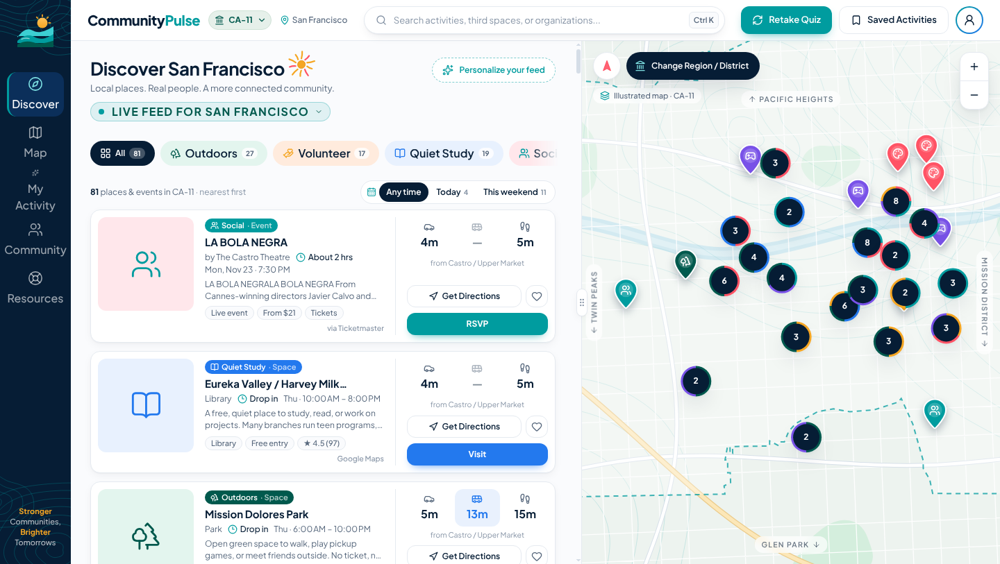

# CommunityPulse

CommunityPulse connects teens with local third spaces, community hubs, and volunteer opportunities to fight social isolation. It works in any congressional district or city: pick one from the region selector or use your device location.

**Try it live:** https://community-pulse-tau.vercel.app



Built for the 2026 Congressional App Challenge with Next.js 16 (App Router), TypeScript, Tailwind CSS 3, framer-motion, Radix-based shadcn/ui primitives, and mapbox-gl.

## What it does

- **Discover:** a live feed of nearby events and drop-in spaces (libraries, parks, community centers, skate parks, cafés, volunteer spots), sorted nearest first, with travel times by car, transit, and walking.
- **Personalize:** a three-question quiz (vibe, how you get around, when you're free) narrows and ranks the feed.
- **Map:** every listing on a map of your district, with the real congressional district outline.
- **My Activity:** save places and RSVP to events; everything stays on your device.
- **Community and Resources:** browse groups by type, and find teen support lines and volunteer networks.

## Run it

```bash
git clone https://github.com/maiti/Community-Pulse.git
cd Community-Pulse
npm install
cp .env.example .env.local   # then fill in the keys you have
npm run dev        # http://localhost:3000
npm run build      # production build
npm run lint
```

You need Node.js 20.9 or newer. Every key is optional. The app works with none of them: it falls back to the illustrated map and the curated sample listings.

### Environment variables

| Variable | What it enables |
| --- | --- |
| `NEXT_PUBLIC_MAPBOX_TOKEN` | Mapbox street tiles. Without it, or if it's rejected, the app draws its own illustrated map. |
| `TICKETMASTER_API_KEY` | Upcoming arts, music, family, and sports events from the [Ticketmaster Discovery API](https://developer.ticketmaster.com/), 45 days ahead. A separate Family search runs alongside the general one so all-ages events aren't crowded out by club shows. |
| `GOOGLE_PLACES_API_KEY` | Libraries, parks, cafés, bowling alleys, community centers, museums, art galleries, arcades, skate parks, pools, and botanical gardens (Nearby Search), plus food banks, youth centers, community gardens, volunteer centers, climbing gyms, and makerspaces (Text Search) from Google Places. Enable **Places API (New)** for the key; the legacy Nearby Search is tried only if the new API is refused. |
| `EVENTBRITE_API_TOKEN` | Eventbrite events. |
| `EVENTBRITE_ORGANIZER_IDS` | Comma-separated Eventbrite organizer IDs to follow (the number at the end of an `eventbrite.com/o/…` URL). Eventbrite shut down public location search in 2020, so the app tries it and then reads these organizers' upcoming events, keeping the ones near the selected area. |

[OpenStreetMap](https://www.openstreetmap.org/) needs no key: libraries, youth and community centers, skate parks, community gardens, and parks come from the public Overpass API on every request (cached for a day).

On Vercel, add the same variables under **Project → Settings → Environment Variables** (or `vercel env add <NAME>`), then redeploy.

## Live data

The browser calls `GET /api/activities?lat=…&lng=…&district=…&vibe=…&transport=…` whenever the location or the quiz picks change.

- **Fan-out:** the route queries Eventbrite, Ticketmaster, Google Places, and OpenStreetMap in parallel with `Promise.allSettled`. A missing key, timeout (8 s), or rate limit only affects that one source, and the response reports each source's status.
- **One schema:** each adapter in `lib/api/` maps its results into the same `Activity` shape as the sample data. Travel times are estimated from straight-line distance. Cards show a category icon rather than a photo, because most sources have no picture of the actual place. Adapters still fill `imageUrl` (a Ticketmaster or Eventbrite photo, or a category stock photo) in case photos come back later.
- **When:** "Today" and "This weekend" (Friday 5 PM through Sunday) narrow events by start date and hide ones that have already ended. Drop-in spaces stay in the feed, since they're open whenever you go.
- **Quiz-aware:** `vibe` limits which kinds of places are searched, and `transport` sets the search radius (2.5 km walking up to 16 km by car).
- **Teen-safe:** events marked 18+ or 21+, cancelled shows, and upsell listings (VIP packages, parking) are dropped. Ticketmaster music, comedy, and uncategorized events are kept only when the listing says all ages (or a minimum age of 14 or under), because club shows are often 21+ without being flagged. Campus libraries are left out, since they usually need a student ID.
- **Volunteer spots:** Google has no place type for food banks, youth centers, or community gardens, so those come from Text Search, with a name check and a radius check on every hit.
- **No duplicates:** a place listed by both Google and OpenStreetMap (same name within 500 m, or the same kind of place within 80 m) appears once, with Google's ratings and hours.
- **Fallback:** fewer than 8 live listings tops the feed up with the curated samples, re-centered on the area. The "Live Feed for …" badge in the feed opens a breakdown of where listings came from.
- **Caching:** upstream calls use Next's data cache (15 minutes for events, 6 hours for Google places, 24 hours for OpenStreetMap), and responses carry `s-maxage` so Vercel's CDN serves repeat requests. Upstream searches are centered on a ~1 km grid point rather than the exact location, and Google and OpenStreetMap always search the same 6 km radius with the same result count, so everyone in a neighborhood shares one set of upstream calls whatever their quiz answers. Distances, travel times, and the per-person radius are still applied from the exact location afterwards.

Google Places requests are billed per call after Google's monthly free tier: one uncached area load makes up to 17 calls (11 Nearby Search, 6 Text Search), fewer when the quiz narrows the vibes. Ratings and opening hours put these calls in Google's Enterprise pricing tier, so set a daily quota in Google Cloud.

## Congressional district lookup

`GET /api/district?lat=…&lng=…` asks the free [US Census Geocoder](https://geocoding.geo.census.gov/geocoder/) which congressional district contains a point and returns `{ district: { code: "CA-11", label: "California's 11th Congressional District", state: "CA" } }`, or `{ district: null }` outside the US. "Use my current location" calls it, so the header shows your real district instead of "Near Me". No key is needed, and answers are cached for a week.

`GET /api/district/boundary?code=CA-11` returns the district's outline as a GeoJSON MultiPolygon from [Census TIGERweb](https://tigerweb.geo.census.gov/arcgis/rest/services/TIGERweb/Legislative/MapServer), simplified to about 50 m. The layer ID changes with each new Congress, so the newest "Nth Congressional Districts" layer is looked up by name. Both maps draw the outline as a dashed teal line: the Mapbox map adds it as a layer under the street labels, and the illustrated map uses it in place of its hand-drawn blob. Non-congressional regions ("Ward 4", "Near Me") and failed lookups keep the illustrated blob. Outlines are cached for a week.

## How it fits together

| Path | What it holds |
| --- | --- |
| `app/api/activities/route.ts` | Unified live-data endpoint |
| `app/api/district/route.ts` | Congressional district for a point (`lib/api/district.ts` parses the Census response) |
| `app/api/district/boundary/route.ts` | District outline from Census TIGERweb (`lib/use-district-boundary.ts` loads it in the browser) |
| `lib/api/` | `eventbrite.ts`, `ticketmaster.ts`, `googlePlaces.ts`, `openStreetMap.ts` adapters, plus `feed.ts`, which merges them |
| `data/activities.json` | 20 curated sample listings (events and spaces) |
| `lib/use-live-activities.ts` | Client fetch with debounce, stale-while-refreshing, and offline fallback |
| `lib/location-state.tsx` | Region profiles (districts and cities) plus device-location detection |
| `lib/app-state.tsx` | Feed filters, quiz picks, saves, RSVPs, map selection |
| `lib/match.ts` | Search, category filtering, and quiz-based ranking |
| `components/` | Shell (`Sidebar`, `Header`), `DiscoveryFeed`, `ActivityCard`, `LiveBadge`, `MapView`, `QuizModal`, sheets and dialogs |
| `components/map/` | Mapbox renderer, illustrated fallback map, shared pin layer |
| `docs/DEMO_SCRIPT.md` | Shot list and narration for the Congressional App Challenge video |

On desktop, drag the handle between the list and the map to resize them (or focus it and use the arrow keys; double-click resets it). Saved activities, RSVPs, quiz picks, the chosen region, and that split are stored in `localStorage`, so they stay on the user's device. Saved and planned listings are kept as snapshots, so they stay in your list after the live feed moves on.

### Adding a new community

Add a profile to `LOCATION_PROFILES` in `lib/location-state.tsx`: code, name, centroid, and the neighborhoods that border it to the north, south, east, and west. Live sources pick it up automatically.

## Deploy

The live site runs on Vercel. Import the repo in Vercel, add any of the environment variables above under **Project → Settings → Environment Variables**, and deploy. No database is needed.

## Team

Built by Yuvaan Maiti, Kai Izzi, and Sean Gupta for the 2026 Congressional App Challenge.

## License

[MIT](LICENSE)
